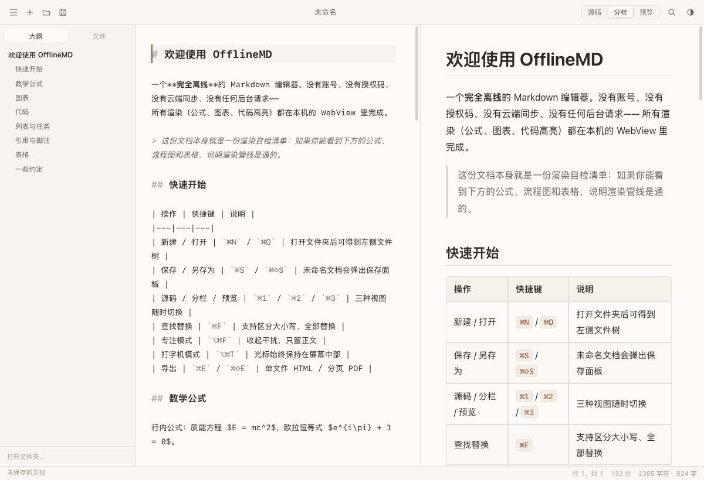
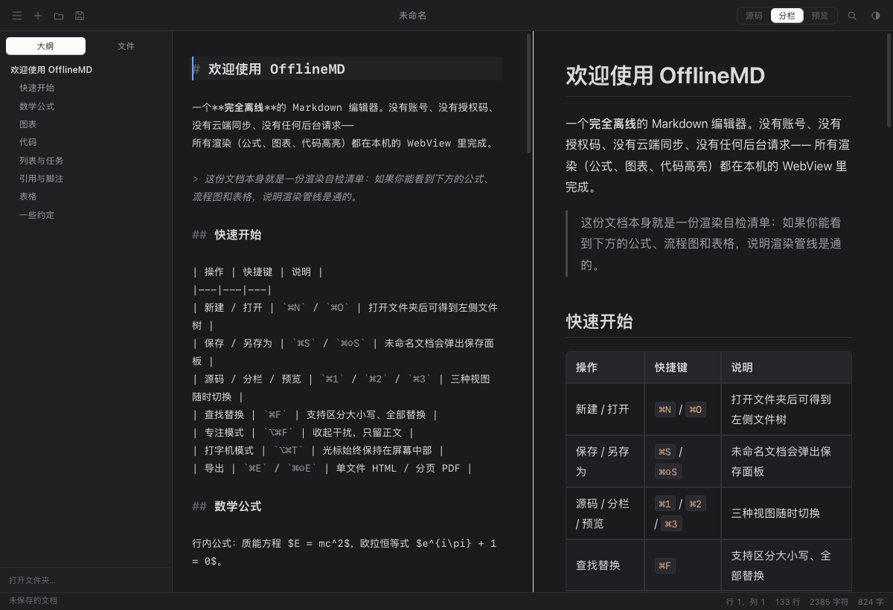
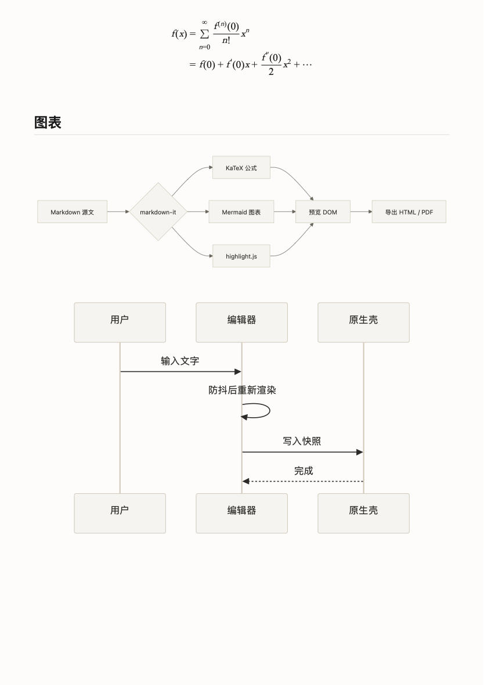

# OfflineMD

<p align="center">
  <b>A lightweight, privacy-first, fully offline Markdown editor for macOS.</b><br>
  一款轻量、所见即所得、完全离线的 macOS 原生 Markdown 编辑器。
</p>

<p align="center">
  
  
  
  
</p>

---

## 🌟 特性亮点

- 🔒 **严格离线与隐私优先**
  - **零网络请求**：无需注册、无账号登录、无遥测上报、无后台更新。
  - **结构性网络阻断**：CSP 硬规则限制 `connect-src 'none'`，原生壳层严格拦截外部 http(s) 导航，所有依赖、字体与静态资源随包打包分发。
- ✍️ **双引擎多视图体验**
  - **所见即所得编辑（⌘1）**：基于现代 ProseMirror / Milkdown 内核，所见即所写，原生标题字号、交互式勾选框、可视化表格。
  - **纯文本源码模式（⌘2）**：集成经典 CodeMirror 5 编辑器，语法高亮、自动配对、光标多选。
  - **双栏分栏对照（⌘3）**：实时左右分栏对照，自由调整窗格比例。
  - **纯净阅读预览（⌘4）**：极简专注阅读体验。
  - **Markdown 唯一真实源**：四种视图无缝平滑切换，内容始终双向精准同步。
- 📐 **强大的排版与扩展语法**
  - **数学公式**：内置 KaTeX 本地离线引擎，秒级渲染行内 `$E=mc^2$` 与块级 `$$` 复杂公式。
  - **交互式图表**：内置 Mermaid 11 离线绘图，支持流程图、时序图、状态图等，样式自动适配当前主题。
  - **代码语法高亮**：集成 highlight.js，支持数十种编程语言代码着色。
  - **GFM 扩展语法**：原生任务列表（点击实时更新 Markdown `[x]`）、真表格编辑、脚注、下划线（`⌘U`）、删除线。
- 🧭 **流畅的文档大纲与文件树**
  - **动态大纲跳转**：左侧多级标题大纲，点击平滑滚动并自动置顶对齐；编辑区滚动时光标联动高亮当前阅读章节。
  - **本地文件树**：一键打开文件夹，递归展示多级 Markdown 文档树。
- 🖼️ **开箱即用的图片与资源管理**
  - 复制或拖拽图片到编辑器，自动存储至文档同级 `assets/` 目录并插入相对路径，便于文档迁移和版本管理。
- 📑 **高质量无损导出**
  - **自包含 HTML**：样式、排版规则与字体全面内联，单个文件随处可看。
  - **A4 分页 PDF**：基于 macOS 原生排版引擎进行智能切页导出，标题不孤立在页末。
- 🎨 **精心调优的内置主题与专注模式**
  - 内置 **纸白（Paper）**、**石墨（Graphite）**、**夜阑（Night）**、**松墨（Moss）** 4 套色彩主题。
  - 支持 **专注模式（Focus Mode）** 与 **打字机模式（Typewriter Mode）**。
  - 本地快照崩溃恢复机制，意外关闭可快速召回修改。

---

## 📸 界面预览

| 纸白主题（Paper） | 夜阑暗色（Night） |
|:---:|:---:|
|  |  |

| 所见即所得编辑（交互勾选） | 离线排版与导出 |
|:---:|:---:|
|  |  |

---

## 🚀 快速上手与构建

### 环境要求
- macOS 13.0 或更高版本
- Xcode Command Line Tools（包含 `swiftc`）
- Node.js（仅用于本地构建期打包，运行时无需 Node）

### 本地构建步骤

```bash
# 1. 克隆仓库
git clone https://github.com/hjhrobthecradle/OfflineMD.git
cd OfflineMD

# 2. 一键打包并组装 macOS 应用程序
node scripts/build.js

# 3. 运行应用程序
open dist/OfflineMD.app
```

构建脚本会自动完成：
- 编译 Swift 原生壳层 (`src/native/`)
- 打包所见即所得核心组件 (`web/src/` -> `web/vendor/wysiwyg.js`)
- 动态绘制并生成高清 `AppIcon.icns`
- 组装 `OfflineMD.app` 独立包结构并执行本地 ad-hoc 签名

> **说明**：仓库中已随附开箱即用的离线前端静态资源（KaTeX、Mermaid、CodeMirror 等均在 `web/vendor/` 目录下），克隆后无需 `npm install` 即可直接构建运行。

---

## ⌨️ 常用快捷键速查

| 快捷键 | 功能 |
|---|---|
| <kbd>⌘</kbd> + <kbd>1</kbd> | 切换为 **所见即所得（编辑）** 视图 |
| <kbd>⌘</kbd> + <kbd>2</kbd> | 切换为 **源码** 视图 |
| <kbd>⌘</kbd> + <kbd>3</kbd> | 切换为 **双栏分栏** 视图 |
| <kbd>⌘</kbd> + <kbd>4</kbd> | 切换为 **预览** 视图 |
| <kbd>⌘</kbd> + <kbd>Z</kbd> / <kbd>⇧</kbd> + <kbd>⌘</kbd> + <kbd>Z</kbd> | 撤销 / 重做 |
| <kbd>⌘</kbd> + <kbd>B</kbd> | **粗体** |
| <kbd>⌘</kbd> + <kbd>I</kbd> | *斜体* |
| <kbd>⌘</kbd> + <kbd>U</kbd> | <u>下划线</u> |
| <kbd>⌥</kbd> + <kbd>⌘</kbd> + <kbd>S</kbd> | ~~删除线~~ |
| <kbd>⇧</kbd> + <kbd>⌘</kbd> + <kbd>`</kbd> | `行内代码` |
| <kbd>⌥</kbd> + <kbd>⌘</kbd> + <kbd>Q</kbd> | 引用块 |
| <kbd>⌥</kbd> + <kbd>⌘</kbd> + <kbd>X</kbd> | 交互式任务列表 |
| <kbd>⌘</kbd> + <kbd>K</kbd> | 插入 / 切换链接 |
| <kbd>⌘</kbd> + <kbd>F</kbd> | 查找文本 |
| <kbd>⌥</kbd> + <kbd>⌘</kbd> + <kbd>F</kbd> | 查找并替换 |
| <kbd>⌃</kbd> + <kbd>⌘</kbd> + <kbd>T</kbd> | 循环切换主题（纸白 / 石墨 / 夜阑 / 松墨） |
| <kbd>⌥</kbd> + <kbd>⌘</kbd> + <kbd>T</kbd> / <kbd>F9</kbd> | 开启 / 关闭打字机居中模式 |
| <kbd>⇧</kbd> + <kbd>⌘</kbd> + <kbd>J</kbd> / <kbd>F8</kbd> | 开启 / 关闭专注聚焦模式 |
| <kbd>⌘</kbd> + <kbd>E</kbd> | 导出为自包含 HTML |
| <kbd>⇧</kbd> + <kbd>⌘</kbd> + <kbd>E</kbd> | 导出为 A4 分页 PDF |
| <kbd>⌘</kbd> + <kbd>=</kbd> / <kbd>⌘</kbd> + <kbd>-</kbd> / <kbd>⌘</kbd> + <kbd>0</kbd> | 放大 / 缩小 / 恢复默认视图大小 |
| <kbd>⌘</kbd> + <kbd>/</kbd> | 查看完整的应用内快捷键面板 |

---

## 🏗️ 架构设计

OfflineMD 采用经典而高效的 **原生轻量外壳 + 高性能 Web 核心** 分层架构：

```
OfflineMD.app
├── Contents/MacOS/OfflineMD          # 原生壳（Swift）
│   ├── main.swift                    # 应用引导入口
│   ├── AppDelegate.swift             # 菜单树、最近文件、系统快捷键分发
│   ├── EditorWindow.swift            # 窗口管理、WKWebView 安全导航白名单
│   ├── Bridge.swift                  # 原生 ↔ Web 桥接消息分发
│   └── Services.swift                # 自定义 scheme (offline-md://)、快照存储、文件树、PDF 渲染导出
└── Contents/Resources/web            # Web 编辑器核心
    ├── index.html                    # 布局框架与 CSP 严格策略
    ├── css/                          # 应用主题样式、正文排版（content.css）与 ProseMirror 挂件
    ├── js/                           # 编辑器主控、渲染管线、公式插件、桥接通信
    └── vendor/                       # 完全随包内嵌的离线第三方库与 KaTeX 字体
```

- **自定义 Scheme (`offline-md://`)**：
  页面与资源均通过原生 `WebSchemeHandler` 从本地 Bundle 加载，规避 `file://` 的同源安全性限制，无需在本地监听 HTTP 端口。
- **双向安全隔离**：
  原生与 Web 前端通信采用 Promise 化的消息桥接，所有文件读写均受限于用户选择的目录沙盒范围。

---

## 📦 开源依赖与致谢

OfflineMD 的实现离不开以下优秀的开源项目（均采用 MIT / BSD / ISC 等宽松开源协议）：

- [Milkdown](https://github.com/Milkdown/milkdown) & [ProseMirror](https://prosemirror.net/) — 所见即所得编辑引擎
- [CodeMirror](https://codemirror.net/) — 经典源码编辑引擎
- [markdown-it](https://github.com/markdown-it/markdown-it) — 快速且可扩展的 Markdown 解析器
- [KaTeX](https://katex.org/) — 高性能快速数学公式排版库
- [Mermaid](https://mermaid.js.org/) — 纯 JavaScript 图表与流程图生成器
- [highlight.js](https://highlightjs.org/) — 代码语法高亮库

---

## 📄 开源许可证

本项目基于 [MIT License](LICENSE) 开源。
